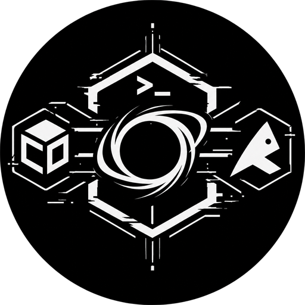

<p align="center">
  
</p>

<h1 align="center">TermuxVoid Website</h1>

<p align="center">
  Official landing page for the TermuxVoid Repository — security tools for Termux, available as both APT (dpkg) and Pacman repositories.
</p>

<p align="center">
  <a href="https://termuxvoid.github.io"></a>
  <a href="https://github.com/TermuxVoid/repo/stargazers"></a>
  <a href="https://github.com/TermuxVoid/repo/blob/main/LICENSE"></a>
  <a href="https://t.me/termuxvoid"></a>
</p>

---

## Overview

A "Live Registry" single-page site built with vanilla HTML, CSS, and JavaScript. It reads package metadata directly from the TermuxVoid repository, so the tool list, counts, versions, and dependencies are never hard-coded. TermuxVoid ships the same tools as both an APT (dpkg) and a Pacman repository, so `pkg install` works on either setup.

The interface uses a dark repository shell with a warm paper content area, an orange accent, tool icons, and a Kali-inspired category/tool layout.

## Features

| Feature | Description |
|---|---|
| **Live Registry** | Every tool, count, version, and dependency is fetched from the remote `Packages` index |
| **Category Filters** | Filter by recon, network, web, exploitation, utilities, development, Android, crypto, OSINT, and other |
| **Tool Icons** | SVG and PNG icons live in `assets/icons/`; a default icon is shown automatically when a package has no icon yet |
| **Tool Detail Pages** | Record sheets with version, architecture, dependencies, install command, and source links |
| **Search** | Search names, descriptions, sections, and categories; press `/` to focus and `Esc` to dismiss |
| **Full-Index Reveal** | The front door shows the first 9 records; one click reveals the full index |
| **Copy to Clipboard** | One-tap copy for repository setup commands and install commands |
| **Theme Switch** | Light and dark themes, persisted in `localStorage`, with system preference as the fallback |
| **Responsive** | Mobile navigation, responsive cards, and a stacked tool detail layout |
| **Zero Dependencies** | Pure HTML/CSS/JS — no bundler, no framework, no npm |

## Project Structure

```
.
├── index.html             # Landing page (hero, registry, install, FAQ, support)
├── tool.html              # Tool detail page
├── assets/
│   ├── logo.png           # Site logo
│   ├── favicon.png        # Favicon
│   └── icons/             # Tool icons (SVG/PNG), category icons, manifest.js, default.svg
├── css/
│   └── style.css          # Tokens, layout, components, responsive rules
├── tools/
│   └── icons-manifest.js  # Regenerates assets/icons/manifest.js
└── js/
    ├── packages.js        # Debian Packages parser and cached fetch (IIFE)
    ├── common.js          # Shared escape, URL, icon, copy, menu, scroll helpers
    ├── app.js             # Registry rendering, filters, search, scroll chrome
    └── theme.js           # Early theme apply + light/dark toggle
```

## Adding a Tool Icon

Icons are looked up by package name through `assets/icons/manifest.js`:

1. Add `assets/icons/<package-name>.svg` or `assets/icons/<package-name>.png`.
2. Run `node tools/icons-manifest.js`.
3. Commit the icon and the regenerated `manifest.js`.

For example, `sqlmap` uses `assets/icons/sqlmap.svg`. If a package has no icon, the page falls back to `assets/icons/default.svg`. Category icons use the `cat-` prefix and are left out of the manifest automatically.

## Getting Started

Clone and open locally:

```bash
git clone https://github.com/TermuxVoid/termuxvoid.github.io.git
cd termuxvoid.github.io
# Open index.html in any browser — no server required
```

Or visit the live site: **[termuxvoid.github.io](https://termuxvoid.github.io)**

## Adding the Repository (Termux)

TermuxVoid ships the same tools as both an APT and a Pacman repository. Add the one matching your setup:

**APT (dpkg) Termux**

```bash
curl -fsSL https://v.gd/termuxvoid_apt | bash
```

**Pacman Termux**

```bash
curl -fsSL https://v.gd/termuxvoid_pacman | bash
```

Once added, install any tool with `pkg install` — it works on both APT and Pacman setups:

```bash
# Install any tool
pkg install <tool-name>
```

## Tech Stack

- **HTML5** — semantic markup
- **CSS3** — custom properties, responsive grid, reduced-motion support
- **Vanilla JS** — IIFE modules, `fetch` API, `Clipboard` API
- **Google Fonts** — Inter (prose and UI) + JetBrains Mono (labels, commands, index data)
- **Icons** — project logos from upstream repositories and websites, a few Kali Linux tool icons, Simple Icons brand marks (CC0), custom SVG/PNG icons, and a default fallback

## Contributing

1. Fork this repository
2. Create a feature branch (`git checkout -b feature/my-change`)
3. Commit your changes (`git commit -m "Add my change"`)
4. Push to the branch (`git push origin feature/my-change`)
5. Open a Pull Request

## Community

- **Telegram:** [@termuxvoid](https://t.me/termuxvoid)
- **YouTube:** [@alienkrishnorg](https://youtube.com/@alienkrishnorg)
- **Issues:** [GitHub Issues](https://github.com/TermuxVoid/repo/issues)
- **Email:** [termuxvoid@gmail.com](mailto:termuxvoid@gmail.com)

## Credits

Some tool icons are from Kali Linux. Some brand marks are from [Simple Icons](https://simpleicons.org/) (CC0 1.0). Other logos belong to their respective projects and are used for identification. Remaining icons are custom assets made for this site. Trademarks remain with their owners.

## License

This project is licensed under the [BSD 3-Clause License](https://github.com/TermuxVoid/repo/blob/main/LICENSE).

---

<p align="center">
  Built for the security research community.
</p>
